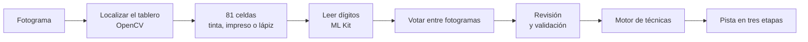

# Sudoku Coach

**Apunta el móvil a un sudoku en papel y recibe el siguiente paso lógico, no la respuesta.**

Sudoku Coach es una app Android que lee con la cámara un sudoku impreso, incluidos los dígitos que ya escribiste a lápiz, y te dice qué técnica humana te desatasca (una posición única, un par señalado, un trío desnudo…) y dónde aplicarla. La pista se revela por etapas, así que puedes parar en cuanto la veas. Todo ocurre en el móvil: sin internet y sin cuenta.

[English](README.md) · [**Descargar la APK**](https://github.com/avargam/proyecto-sudoku/releases/latest) · [Cambios](CHANGELOG.md) (en inglés)

<p align="center">
  
</p>

## Instalar

1. En un móvil con Android 8.0 o superior, abre la [última versión](https://github.com/avargam/proyecto-sudoku/releases/latest) y descarga `sudoku-coach-<versión>-arm64-v8a.apk`.
2. Abre el archivo. Android te pedirá permitir que el navegador o el gestor de archivos instale apps; permítelo para esta instalación.
3. Concede el permiso de la cámara cuando la app lo pida. Sin él, puedes seguir abriendo fotos de la galería.

La APK `x86_64` es para el emulador de Android en un PC, donde solo tiene sentido la galería. Cada versión trae las sumas SHA-256, y las versiones nuevas se instalan encima de las anteriores. La app está en español.

## Qué hace

- **Escanea en tiempo real.** El tablero se resalta en cuanto entra en el visor. Al mantener el móvil quieto, la app lee varios fotogramas, vota cada celda y abre sola la revisión, normalmente en menos de 2 segundos. Hay un disparador manual, linterna y galería como alternativas.
- **Te deja comprobar la lectura.** Las celdas de las que la app no está segura se marcan para corregirlas con el teclado. Antes de dar una pista comprueba que no haya dígitos repetidos ni contrarios a la solución, y que el sudoku tenga solución única.
- **Enseña en lugar de resolver.** Busca la técnica más simple que permite avanzar y la revela en tres etapas: la técnica, dónde mirar y qué colocar o descartar, con una explicación. Puedes aplicar el paso y seguir, o revelar un solo dígito cuando no queda técnica.

## Cómo funciona



1. **Detección** (`vision-core`, OpenCV): el contorno más grande casi cuadrado se endereza con una homografía y solo se acepta si dentro aparece una rejilla de 9 × 9. En cada celda se busca tinta, y el lápiz se distingue del impreso por el contraste, así que la app sabe qué dígitos son tuyos.
2. **Reconocimiento** (`vision`, ML Kit Text Recognition): las celdas con tinta se redibujan en una lámina compacta, sin rejilla, que se lee de una sola vez. Resultó mucho más preciso que leer celda a celda.
3. **Votación en vivo** (`vision-core` y `app`, CameraX): con el tablero quieto se leen 3–4 fotogramas y cada celda se decide por mayoría, con una confianza combinada. Los trazos a lápiz muy tenues, que solo se ven en algunos fotogramas, se marcan para revisar en lugar de perderse.
4. **Motor de técnicas** (`solver`, Kotlin puro): aplica técnicas humanas por orden de dificultad y describe cada paso como datos (celdas, dígitos, eliminaciones). La app los convierte en el texto de la explicación.

## Lo destacable

- **El motor coincide con un solver de referencia.** 13 técnicas, de los únicos a las intersecciones y los subconjuntos desnudos y ocultos, coinciden con [HoDoKu](https://hodoku.sourceforge.net/) en los 16 753 pasos de un banco de 300 sudokus.
- **Lo difícil es la letra a mano.** En fotos de prueba de un libro de sudokus real, el lector acierta el 100 % de los dígitos impresos y el 94,6 % de los manuscritos.
- **Ningún error pasa en silencio.** En 32 fotos, 12 secuencias grabadas con la cámara y 720 reproducciones de ellas, todo dígito mal leído queda marcado para revisar. A cambio, hay unas 14 celdas marcadas por tablero que mirar; un modelo de dígitos propio es lo siguiente en la hoja de ruta para reducirlas.
- **Rápida en un móvil de gama media.** En un Samsung Galaxy A57, de quieto a la revisión pasan 1,26 s (mediana), analizando ≈ 22 fotogramas por segundo.

Hecha con Kotlin, Jetpack Compose, Navigation 3, CameraX, OpenCV 4 y ML Kit.

## Compilar desde el código

Requisitos (Linux, macOS o WSL):

- JDK 21.
- El SDK de Android con `platforms;android-37.0` y `build-tools;37.0.0`, y `ANDROID_HOME` apuntando a él (o `sdk.dir` en `local.properties`).
- En Linux, GTK 2 para los nativos de OpenCV que usan los tests de `vision-core` (`sudo apt install libgtk2.0-0t64` en Ubuntu).

```bash
./gradlew :solver:test :vision-core:test :app:testDebugUnitTest   # tests en la JVM, sin móvil
./gradlew :app:assembleDebug                                      # app/build/outputs/apk/debug/app-debug.apk
./gradlew :app:assembleRelease                                    # una APK por ABI, sin firmar si no hay clave de release
```

| Tests | Qué necesitan |
|---|---|
| Tests unitarios de `solver`, `vision-core` y `app` | Solo los requisitos; la CI los pasa en cada push |
| Tests instrumentados de `vision` y `app` (`connectedDebugAndroidTest`) | Un móvil por USB (`adb devices`) |
| Secuencias grabadas con la cámara (`SequenceReplayTest`, `LiveTuningTest`, `SequenceScanTest`) | Secuencias grabadas con la versión de debug; no están en el repo, así que estos tests se saltan |
| Originales de la cámara a tamaño completo (`PhotoScanTest`, `EndToEndTest`) | Se usan si están en el móvil; las fotos reducidas de `testdata/` se usan siempre |

La versión de debug tiene en el escáner un botón **Grabar** que guarda secuencias para estos tests; en `tools/vision/` están los scripts para traerlas, etiquetarlas y reproducirlas.

## Estructura

```
solver/        Motor de técnicas y un solver por backtracking para validar tableros (Kotlin puro, JVM)
vision-core/   Detección del tablero, segmentación de celdas y votación entre fotogramas (Kotlin + OpenCV, JVM)
vision/        Reconocimiento de dígitos en Android (OpenCV + ML Kit)
app/           App Android (Jetpack Compose, CameraX)
testdata/      Fotos de prueba de páginas de sudokus, etiquetadas
tools/         Oráculo de HoDoKu para los tests del solver, y scripts de fotos y secuencias
```

Los comentarios del código citan decisiones de diseño (D-01, D-02…) y tareas (4.5, P.3…) de las notas de diseño del proyecto, que son privadas.

## Estado y hoja de ruta

La app funciona de principio a fin: escáner en vivo, revisión, pistas y fotos de la galería. Lo siguiente:

1. **Un modelo de dígitos propio** (una CNN pequeña en LiteRT) entrenado con letra a mano, para marcar menos celdas. La mayoría de las que quedan son 1 manuscritos que ML Kit lee como 4.
2. **Técnicas avanzadas:** X-Wing y peces, XY-Wing y otras alas, Unique Rectangle, coloración y cadenas.
3. **Pulido:** la pista dibujada sobre la imagen de la cámara y una revisión de accesibilidad.

## Datos de prueba

`testdata/vision/photos/` tiene 30 fotos de páginas de un libro de sudokus impreso, reducidas y sin metadatos. Solo sirven para medir la visión, y todas las cifras de arriba salen de ese único libro.

## Créditos y licencia

Sudoku Coach tiene licencia [Apache-2.0](LICENSE). Usa [OpenCV](https://opencv.org/) (Apache-2.0), el reconocimiento de texto de [Google ML Kit](https://developers.google.com/ml-kit) y la tipografía [IBM Plex Sans](https://github.com/IBM/plex) (SIL Open Font License, incluida en la app). [HoDoKu](https://hodoku.sourceforge.net/) (GPL) solo se usa como oráculo de tests en el equipo de desarrollo y no forma parte de este repositorio ni de la app.
