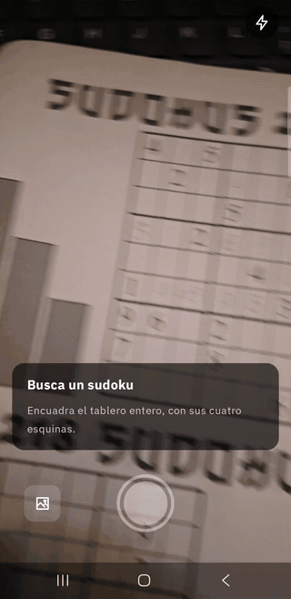
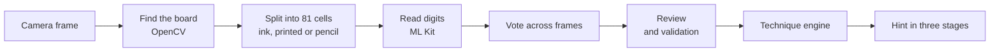

# Sudoku Coach

**Point your phone at a paper sudoku and get the next logical step, not the answer.**

Sudoku Coach is an Android app that reads a printed sudoku with the camera, including the digits you've already pencilled in, and tells you which human technique gets you unstuck (a Hidden Single, a Pointing pair, a Naked Triple…) and where to apply it. The hint is revealed in stages, so you can stop as soon as you see it. Everything runs on the phone: no internet, no account.

[Español](README.es.md) · [**Download the APK**](https://github.com/avargam/proyecto-sudoku/releases/latest) · [Changelog](CHANGELOG.md)

<p align="center">
  
</p>

## Install

1. On an Android 8.0+ phone, open the [latest release](https://github.com/avargam/proyecto-sudoku/releases/latest) and download `sudoku-coach-<version>-arm64-v8a.apk`.
2. Open the file. Android will ask you to allow installing apps from your browser or file manager; allow it for this install.
3. Grant camera access when the app asks. Without it, you can still open photos from the gallery.

The `x86_64` APK is for the Android emulator on a PC, where only the gallery is useful. Each release lists SHA-256 checksums, and later versions install over earlier ones. The app's interface is in Spanish.

## What it does

- **Scans in real time.** The board is outlined as soon as it's in view. When you hold still, the app reads several frames, votes on each cell and opens the review on its own, usually in under 2 seconds. A manual shutter, a torch and a photo picker are there as fallbacks.
- **Lets you check the reading.** Cells the app isn't sure about are outlined so you can fix them with the keypad. Before giving a hint, it checks for repeated digits, digits that contradict the solution and whether the puzzle has a unique solution.
- **Coaches instead of solving.** It finds the simplest technique that makes progress and reveals it in three stages: the technique, where to look, and what to place or eliminate, with an explanation. You can apply the step and continue, or reveal a single digit when no technique applies.

## How it works



1. **Detection** (`vision-core`, OpenCV): the largest roughly square outline is straightened with a homography and kept only if a 9 × 9 grid shows up inside it. Each cell is checked for ink, and pencil is told apart from print by contrast, so the app knows which digits are yours.
2. **Recognition** (`vision`, ML Kit Text Recognition): the inked cells are redrawn as a compact sheet, without grid lines, and read in a single call. That turned out far more accurate than reading cells one by one.
3. **Live voting** (`vision-core` and `app`, CameraX): while the board is still, 3–4 frames are read and every cell is decided by majority, with a combined confidence. Faint pencil marks that only show up in some frames are flagged for review instead of being lost.
4. **Technique engine** (`solver`, pure Kotlin): applies human techniques in order of difficulty and describes each step as data (cells, digits, eliminations). The app turns that into the explanation text.

## Highlights

- **The engine agrees with a reference solver.** 13 techniques, from singles through locked candidates to naked and hidden subsets, match [HoDoKu](https://hodoku.sourceforge.net/) on all 16,753 steps of a 300-puzzle bank.
- **Handwriting is the hard part.** On test photos of a real puzzle book, the reader gets 100 % of printed digits and 94.6 % of handwritten ones right.
- **Errors are never silent.** Across 32 photos, 12 recorded camera sequences and 720 replays of them, every misread digit is flagged for review. The trade-off is about 14 flagged cells per board to glance at; a custom digit model is next on the roadmap to bring that down.
- **Fast on a mid-range phone.** On a Samsung Galaxy A57, from holding still to the review screen takes 1.26 s (median), with frames analysed at ≈ 22 fps.

Built with Kotlin, Jetpack Compose, Navigation 3, CameraX, OpenCV 4 and ML Kit.

## Build from source

Requirements (Linux, macOS or WSL):

- JDK 21.
- The Android SDK with `platforms;android-37.0` and `build-tools;37.0.0`, and `ANDROID_HOME` pointing at it (or `sdk.dir` in `local.properties`).
- On Linux, GTK 2 for the OpenCV natives used by the `vision-core` tests (`sudo apt install libgtk2.0-0t64` on Ubuntu).

```bash
./gradlew :solver:test :vision-core:test :app:testDebugUnitTest   # JVM tests, no phone needed
./gradlew :app:assembleDebug                                      # app/build/outputs/apk/debug/app-debug.apk
./gradlew :app:assembleRelease                                    # one APK per ABI, unsigned without a release key
```

| Tests | Needs |
|---|---|
| `solver`, `vision-core`, `app` unit tests | Nothing beyond the requirements; CI runs them on every push |
| `vision` and `app` instrumented tests (`connectedDebugAndroidTest`) | A phone over USB (`adb devices`) |
| Recorded camera sequences (`SequenceReplayTest`, `LiveTuningTest`, `SequenceScanTest`) | Sequences recorded with the debug build; they aren't in the repo, so these tests are skipped |
| Full-size camera originals (`PhotoScanTest`, `EndToEndTest`) | Used if present on the phone; the reduced photos in `testdata/` are always used |

The debug build has a **Grabar** (record) button in the scanner that saves camera sequences for these tests; `tools/vision/` has the scripts to pull, label and replay them.

## Project structure

```
solver/        Technique engine, plus a backtracking solver used to validate boards (pure Kotlin, JVM)
vision-core/   Board detection, cell segmentation and frame voting (Kotlin + OpenCV, JVM)
vision/        Digit recognition on Android (OpenCV + ML Kit)
app/           Android app (Jetpack Compose, CameraX)
testdata/      Labelled test photos of puzzle pages
tools/         HoDoKu oracle for the solver tests, and scripts for photos and sequences
```

Code comments refer to design decisions (D-01, D-02…) and tasks (4.5, P.3…) from the project's design notes, which are kept private.

## Status and roadmap

The app works end to end: live scanning, review, hints and photos from the gallery. Next:

1. **A custom digit model** (a small CNN on LiteRT) trained on handwriting, to flag fewer cells. Most remaining flags are handwritten 1s that ML Kit reads as 4s.
2. **Advanced techniques:** X-Wing and fish, XY-Wing and other wings, Unique Rectangle, coloring and chains.
3. **Polish:** the hint drawn over the live camera image, and an accessibility review.

## Test data

`testdata/vision/photos/` holds 30 photos of pages from one printed puzzle book, reduced and stripped of metadata. They are there only to measure the vision pipeline, and every figure above comes from that one book.

## Credits and license

Sudoku Coach is licensed under [Apache-2.0](LICENSE). It uses [OpenCV](https://opencv.org/) (Apache-2.0), [Google ML Kit](https://developers.google.com/ml-kit) text recognition, and the [IBM Plex Sans](https://github.com/IBM/plex) typeface (SIL Open Font License, included in the app). [HoDoKu](https://hodoku.sourceforge.net/) (GPL) is used only as a test oracle on the developer's machine and is not part of this repository or the app.
